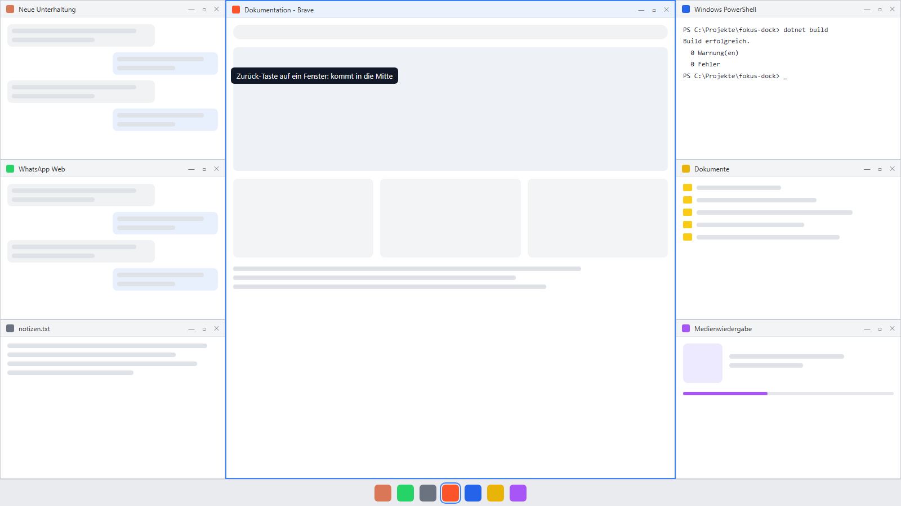
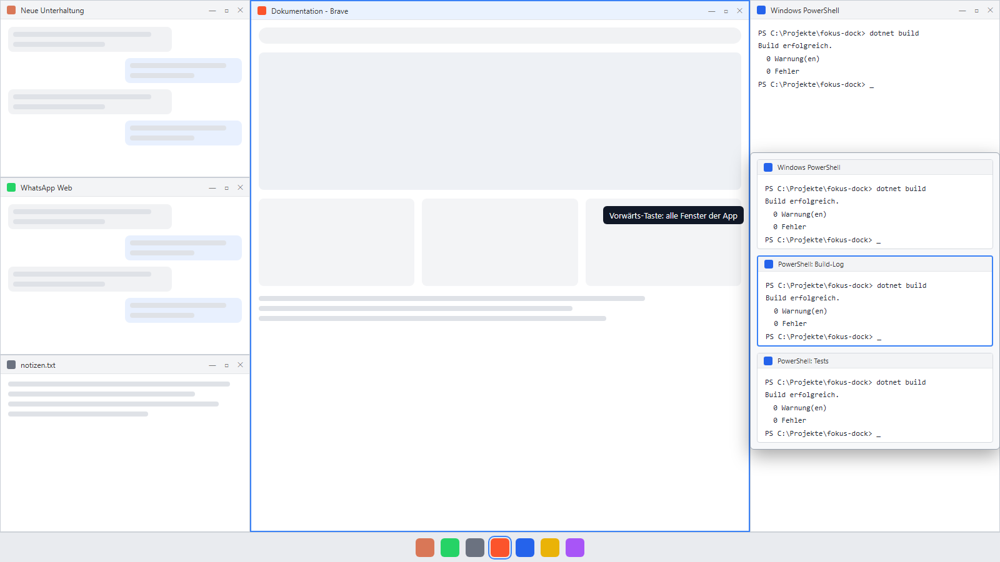

# Fokus-Dock

Drei-Spalten-Layout: Links und rechts stehen echte Fenster übereinander, in der Mitte liegt das aktive Fenster. Alle Fenster sind normal bedienbar. Die Windows-Taskleiste bleibt die Leiste.

```
+-----------+-----------------------+-----------+
| Fenster 1 |                       | Fenster 4 |
+-----------+     Mitte-Fenster     +-----------+
| Fenster 2 |   (echtes Fenster)    | Fenster 5 |
+-----------+                       +-----------+
| Fenster 3 |                       | Fenster 6 |
+-----------+-----------------------+-----------+
```





*Mockups mit Beispielinhalten, keine echten Bildschirmfotos.*

## Start

Voraussetzung: .NET 8 Desktop Runtime (Windows x64).

```
publish\FokusDock.exe
```

Es läuft nur eine Instanz. Fokus-Dock hat kein Hauptfenster, sondern ein Symbol im Infobereich der Taskleiste. Ein zweiter Start öffnet die Prioritätsliste der laufenden Instanz. Beenden mit `Strg+Alt+Q` oder über das Menü des Symbols. Beim ersten Start ohne `config.json` öffnet sich die Bedienungshilfe von selbst.

## Bedienung

| Aktion | Wirkung |
|---|---|
| Klick in ein Fenster einer Spalte | Ganz normale Bedienung, das Fenster bleibt in seinem Platz. |
| **Zurück-Taste der Maus** auf ein Fenster einer Spalte | Dieses Fenster kommt in die Mitte. Das bisherige Mitte-Fenster rückt auf den freigewordenen Platz (Tausch). |
| **Vorwärts-Taste der Maus** auf eine Spalte | Vorschauen aller Fenster dieser App erscheinen über dem Platz, alle auf einen Blick (gescrollt wird nur bei sehr vielen Fenstern). Ein Klick auf eine Vorschau setzt dieses Fenster in den Platz, die Zurück-Taste auf einer Vorschau holt es in die Mitte. Die Liste schließt mit `Esc`, mit einem zweiten Druck der Vorwärts-Taste, mit einem Klick daneben oder wenn die Maus sie verlässt. |
| `Strg+Alt+F` | Spalten ein/aus. Das Mitte-Fenster bleibt, wo es ist. |
| **Fenster ziehen** und über einem Platz loslassen | Das Fenster rastet dort ein. Seine App bekommt diesen Platz fest (gespeichert), die bisherige App tauscht auf den alten Platz. Über der Mitte losgelassen wird es das Mitte-Fenster, über dem Sammelplatz wandert die App dorthin und bleibt dort, bis du sie wieder auf einen Platz ziehst. Größe ändern löst kein Einrasten aus. |
| `Strg+Alt+P` | Prioritätsliste: alle bekannten Apps, vorne = wichtiger. Jede Zeile zeigt Rang, ob die App läuft, und ihren Platz. Unter der Liste stehen „Platz garantiert“, „Nicht verwalten“ und „Entfernen“ für die gewählte App. ▲/▼ (auch Alt+↑/↓) und diese Einstellungen werden sofort in `config.json` gespeichert. „Plätze neu verteilen“ belegt die Plätze nach der Reihenfolge neu. |
| `Strg+Alt+Q` | Beendet Fokus-Dock. |
| **Shift** beim Loslassen eines gezogenen Fensters | Das Fenster wird frei abgelegt: kein Einrasten, nichts wird gespeichert. Beim Ziehen zeigt eine Vorschau, wohin das Fenster einrasten würde. |
| `Esc` | Schließt die offene Fensterliste und die Fokus-Dock-Fenster (Prioritätsliste, Layout, Bedienung). |
| `F1` | Öffnet die Bedienungshilfe aus der Prioritätsliste, dem Layout und der Hilfe selbst. |
| **Symbol im Infobereich** | Linksklick öffnet die Prioritätsliste. Das Menü (Rechtsklick) schaltet die Spalten ein/aus, öffnet Prioritätsliste, Layout… und Bedienung…, öffnet `config.json`, startet Fokus-Dock neu und richtet den Start mit Windows ein. Grau heißt: Spalten aus. |

**Layout…** (Menü des Symbols oder Knopf in der Prioritätsliste) öffnet einen Editor für die Plätze: Plätze teilen, zusammenführen und leeren, Apps per Ziehen fest zuweisen, Zeilen je Seite und Breite der Mitte einstellen. „Übernehmen“ wirkt sofort und speichert in `config.json`.

Der **Sammelplatz** ist der unterste Platz rechts: Dort liegen alle Apps, die keinen eigenen Platz bekommen, übereinander, das zuletzt aktive Fenster vorne. Zurück-Taste holt ein Fenster in die Mitte, Vorwärts-Taste zeigt die Vorschauen aller dieser Fenster, sortiert nach Priorität und scrollbar. Abschalten mit `"overflowCorner": false`.

Jede geöffnete App erscheint automatisch: Hat ein Fenster keinen passenden Eintrag in `apps`, legt Fokus-Dock einen an (Name aus der Dateibeschreibung der EXE), hängt ihn hinten an die Liste und speichert ihn.

Jede App hat einen Platz. Pro Platz steht das zuletzt aktive Fenster der App vorne, die anderen Fenster derselben App liegen direkt dahinter. Öffnet eine App ein neues Fenster, wird es in den Platz eingesetzt.

## config.json

Die Datei liegt neben `FokusDock.exe`. Fehlt sie, gelten die Standardwerte. Nach Änderungen: Infobereich › Neu starten. Kommentare in `config.json` gehen beim Speichern verloren, weil Fokus-Dock die Datei neu schreibt.

| Schlüssel | Bedeutung |
|---|---|
| `tilesPerSide` | Plätze pro Seite: `2` oder `3` (Standard 3). Gilt nur, solange `cells` fehlt. |
| `centerPercent` | Breite des Mitte-Fensters in Prozent der Arbeitsbereichsbreite, `40` bis `60` (Standard 50). Die Seiten bekommen je `(100 − centerPercent) / 2`. |
| `startInCenter` | App, deren Fenster beim Start in der Mitte steht (Standard `"Brave"`), falls sie läuft. |
| `hideDelayMs` | Wartezeit, bis die Fensterliste nach Verlassen ausgeblendet wird (Standard 400). |
| `hotkey` | Tastenkürzel für Ein/Aus, Standard `"Ctrl+Alt+F"`. |
| `exitHotkey` | Tastenkürzel zum Beenden, Standard `"Ctrl+Alt+Q"`. |
| `priorityHotkey` | Tastenkürzel für die Prioritätsliste, Standard `"Ctrl+Alt+P"`. |
| `overflowCorner` | Sammelplatz unten rechts für alle Apps ohne eigenen Platz (Standard `true`). |
| `notifications` | Bereich für das Benachrichtigungsfeld, siehe unten. Ohne Eintrag gibt es kein Feld. |
| `sizeButtons` | Knöpfe zum Teilen und Zusammenlegen oben in der Mitte der Plätze (Standard `true`). |
| `cells` | Die Plätze als Rechtecke (`id`, `side` `left`/`right`, `x`, `y`, `w`, `h` als Anteil 0 bis 1 der Seitenspalte, `app` = feste App). Fehlt `cells`, entsteht das Raster aus `tilesPerSide`. Am besten im Layout-Fenster bearbeiten. |
| `apps` | Liste der Apps. Die Reihenfolge ist die Startbelegung der Plätze: erst links von oben nach unten, dann rechts. Apps ohne Platz bleiben ohne Platz. Neu erkannte Apps werden automatisch hinten angehängt. |

Tastenkürzel brauchen mindestens einen Modifier. Modifier `Ctrl`/`Strg`, `Alt`, `Shift`, `Win`, dazu eine Taste, z. B. `"Win+Shift+D"`. Ist ein Kürzel ungültig oder von einem anderen Programm belegt, meldet Fokus-Dock das beim Start.

Ein Eintrag in `apps`:

```json
{ "name": "Claude", "processes": [ "Claude.exe" ] }
```

Weitere Felder eines Eintrags: `titleStartsWith` (Web-Apps, siehe unten), `alwaysOutside` (Platz garantiert: die App bekommt immer einen Platz), `inCorner` (wird von Fokus-Dock gesetzt, wenn du eine App auf den Sammelplatz ziehst) und `ignored` (`true` = nicht verwalten: Fokus-Dock fasst die Fenster dieser App nie an).

`processes` sind Prozessnamen mit Endung. Sie findest du im Task-Manager (Spalte „Details“). Ein Eintrag mit mehreren Prozessen fasst deren Fenster zu einer App zusammen, z. B. PowerShell mit `powershell.exe`, `pwsh.exe` und `WindowsTerminal.exe`.

### Web-Apps

Web-Apps (Brave-Verknüpfungen) sind eigene Apps:
- Sie laufen in `brave.exe`. Ein Fenster gehört zur Web-App, wenn sein Titel mit `titleStartsWith` beginnt und nicht auf ` - Brave` endet. Normale Brave-Tabs bleiben bei Brave.
- Web-Apps müssen in der Liste vor `Brave` stehen, sonst gehören ihre Fenster zu Brave.
- **Vivaldi:** Web-Apps in `vivaldi.exe` erkennt Fokus-Dock von selbst. Fenster ohne ` - Vivaldi` im Titel sind Web-Apps, alle anderen gehören zum Browser-Eintrag. Jede Web-App wird als eigene App aufgenommen, benannt nach dem ersten Teil des Titels (vor ` - ` oder ` — `), und mit `titleStartsWith` gespeichert. Gibt es die Web-App schon als Eintrag, etwa aus Brave, wird `vivaldi.exe` dort ergänzt statt einen zweiten Eintrag anzulegen.

Standardliste: Claude, die Web-App WhatsApp Web, Brave, PowerShell und Explorer. Eine Vorlage mit allen Feldern liegt in `config.example.json`. Kopiere sie nach `config.json` und passe sie an. `config.json` ist persönlich und wird nicht ins Repository übernommen.

## Grenzen

- Kein Administratorrecht nötig. Fenster von Apps mit Admin-Rechten lassen sich nur platzieren, wenn Fokus-Dock selbst als Administrator läuft.
- Die Zurück- und Vorwärts-Taste sind global: Auf einem Fenster in einer Spalte wird der Klick abgefangen. Die Zurück-Funktion im Browser funktioniert dort also nicht.
- Die Spalten reservieren keinen Platz im Arbeitsbereich. Maximierte Fenster werden am linken und rechten Rand überlagert.
- Fenster, die man verschiebt oder in der Größe ändert, werden nicht sofort zurückgesetzt. Die Plätze werden neu eingerichtet, wenn sich die Fensterliste der App ändert.

## Plätze teilen und zusammenlegen

Oben in der Mitte jedes Platzes und des Benachrichtigungsfelds stehen drei Knöpfe, dezent, bis die Maus darüber ist:
- **Viereck mit senkrechter Linie:** teilt in links und rechts, die Breite wird halbiert.
- **Viereck mit waagerechter Linie:** teilt in oben und unten, die Höhe wird halbiert.
- **Plus:** legt zusammen. Der Platz wird doppelt so groß und nimmt den Nachbarn mit gleicher Kante auf, bei einem schmalen Platz zuerst den neben ihm, sonst den darüber oder darunter.

Beim Teilen entsteht in der freien Hälfte ein neuer Platz. Liegen in der geteilten Zelle hinter dem vordersten Fenster weitere Fenster, kommen genau diese in den neuen Platz (gestapelt, vorne das zuletzt aktive) und bleiben dort, bis du sie in die Mitte holst, woanders einrastest oder schließt. Gibt es keine Hintergrundfenster, füllt Fokus-Dock den Platz mit der nächsten laufenden App ohne Platz. Die Gesamtgröße der Spalten und die Breite der Mitte ändern sich nie, und die Mitte hat keine Knöpfe. Geteilt wird nur bis etwa ein Fünftel der Spaltenbreite und ein Zehntel der Spaltenhöhe. Ein aufgenommener Platz verliert seine feste App, die App bekommt beim nächsten Abgleich einen anderen Platz. Plätze und Teilung werden in `config.json` gespeichert, eine Teilung lässt sich auch im Layout-Editor sehen und ändern. Gibt es keine weitere Teilung oder keinen Nachbarn, erscheint ein Hinweis. Abschalten mit `"sizeButtons": false`.

## Benachrichtigungsfeld

Ein Bereich neben den Plätzen zeigt die Windows-Benachrichtigungen schlicht als Karten, neueste oben: Name der App, Zeit, Titel und Text. Ein Klick auf eine Karte räumt sie weg (auch aus dem Info-Center), „Alle löschen“ leert alles. Das Feld liegt über den anderen Fenstern, nimmt keinen Fokus und verschwindet bei ausgeschaltetem Fokus-Dock und bei Vollbild.

Der Bereich steht in `config.json` und liegt außerhalb von `cells`, dort stehen also keine Fenster. Die Anteile gelten wie bei einem Platz für den Seitenbereich. Eine halbe Zelle unten rechts in der linken Spalte:

```json
"notifications": { "side": "left", "x": 0.5, "y": 0.6667, "w": 0.5, "h": 0.3333 }
```

Beim ersten Mal fragt Windows nach der Erlaubnis, Benachrichtigungen zu lesen (Einstellungen › Datenschutz und Sicherheit › Benachrichtigungen). Die Pop-ups von Windows selbst bleiben, sie lassen sich über die Windows-Einstellungen oder „Nicht stören“ abschalten.

## Build

Das Projekt zielt auf `net8.0-windows10.0.19041.0`, damit die Windows-Benachrichtigungen lesbar sind. Beim ersten Build lädt NuGet dafür das Paket `Microsoft.Windows.SDK.NET.Ref` (etwa 9 MB). Ist auf dem Rechner keine NuGet-Quelle eingerichtet: `dotnet restore --source https://api.nuget.org/v3/index.json`.

```
dotnet build -c Release
dotnet publish -c Release -r win-x64 --self-contained false -o publish
```

## Dateien

| Datei | Inhalt |
|---|---|
| `DockWindow.xaml(.cs)` | Unsichtbarer Träger für Tastenkürzel, Mausfilter und Timer; Plätze, Mitte, Tausch |
| `MouseHook.cs` | Globaler Mausfilter für die Zusatztasten der Maus (WH_MOUSE_LL) |
| `WindowListWindow.cs` | Scrollbare Fensterliste (Vorwärts-Taste) |
| `ThumbnailWindow.cs` | Gemeinsame DWM-Thumbnail-Logik der Liste |
| `DockLayout.cs` | Aufteilung des Arbeitsbereichs in Plätze und Mitte |
| `WindowFinder.cs` | Fenster finden, filtern, Apps zuordnen (inkl. Web-Apps) |
| `WindowPlacer.cs` | Fenster in Plätze und in die Mitte setzen |
| `TrayIcon.cs` | Symbol und Menü im Infobereich, Neustart, Start mit Windows |
| `Theme.cs` | Dunkles Farbschema und Fensterstil (Farben in `App.xaml`) |
| `OverlayWindow.cs` | Durchsichtige Fenster ohne Fokus, Zielvorschau beim Ziehen |
| `Toast.cs` | Kurze Hinweise unten am Bildschirm |
| `SizeButtons.cs` | Teilen und Zusammenlegen der Plätze, die Knöpfe oben in der Mitte |
| `NotificationPanel.cs` | Benachrichtigungsfeld: Windows-Benachrichtigungen als Karten |
| `HelpWindow.cs` | Bedienungshilfe (Maus, Tastatur, Begriffe) |
| `Native.cs` | P/Invoke (user32, dwmapi, kernel32) |
| `AppConfig.cs`, `Monitors.cs` | Config und Monitorhilfen |

## Lizenz

Apache License 2.0, siehe [LICENSE](LICENSE).
